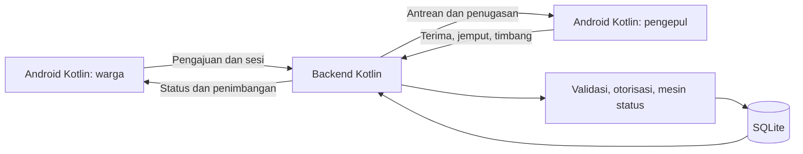

# Recygo

**Status pengembangan dijeda atas permintaan pengguna.** Catatan untuk pengembang berikutnya: [HANDOFF.md](HANDOFF.md). APK terbaru sudah dibuild tetapi belum dipasang; versi di HP masih mendahului perbaikan masking password terakhir.

Aplikasi **Mobile Android** dengan **Kotlin** untuk pengajuan penjemputan sampah, pemrosesan oleh pengepul, dan konfirmasi penimbangan. Subtema: **Green Environment**.

> **MVP demonstrasi lokal.** Backend dan APK debug telah dibangun; 19 pengujian backend lulus. Alur akun dan penjemputan lengkap sudah diuji pada HP Android; pemeriksaan visual akhir masih berlangsung. Belum ada penjemputan publik, mitra terverifikasi, atau penukaran poin bernilai uang. Proyek belum siap submission.

## Tim

**Nama tim: Masukan text...**

| No. | Anggota |
| --- | --- |
| 1 | Sagara Dwi Septiansyah |
| 2 | Arbi Alviano |
| 3 | Mikael Putra Wibowo |
| 4 | Denistia Hermawan |

## Masalah, solusi, dan target pengguna

Pemilahan perlu diikuti jalur pengumpulan dan pencatatan yang jelas. Permen LHK 14/2021 mengatur pengelolaan sampah pada bank sampah, termasuk pemilahan serta pencatatan jenis dan volume. Ini menjadi konteks masalah, bukan bukti dampak Recygo. [Permen LHK 14/2021](https://peraturan.bpk.go.id/Download/285310/Permen%20LHK%20Nomor%2014%20Tahun%202021-.pdf).

**Hipotesis sasaran:** rumah tangga dan mahasiswa yang membutuhkan panduan, pengajuan penjemputan, dan kejelasan status; pengepul yang memerlukan antrean serta catatan berat aktual. Hipotesis ini belum divalidasi melalui wawancara pengguna/mitra.

Alur solusi: warga memilih sampah → mengajukan alamat dan jadwal → pengepul menerima dan menjemput → pengepul mencatat berat aktual → warga mengonfirmasi → riwayat tersimpan. Pengajuan tidak otomatis berarti penjemputan terkonfirmasi. Tidak ada klaim CO₂ berkurang atau sampah berhasil didaur ulang. Riset dan batas klaim: [docs/RESEARCH.md](docs/RESEARCH.md).

## Fitur yang sudah tersedia dalam kode

- Splash, welcome, penjelasan izin lokasi/notifikasi opsional, dan pilihan peran.
- Pendaftaran warga dua langkah dan pengepul tiga langkah, foto pilihan, serta persetujuan penggunaan data demo.
- Login nomor/email + password; OTP untuk pendaftaran dan lupa password melalui kotak masuk demo lokal.
- Reset password mencabut seluruh sesi; logout mencabut sesi saat ini.
- Profil tersimpan di backend, pengeditan kontak/alamat, serta kendaraan/wilayah pengepul.
- Panduan serta pemilihan plastik, kertas, kaca, dan logam. “Lainnya” tampil sebagai belum tersedia.
- Pengajuan dengan validasi jenis, perkiraan berat, alamat, tanggal, slot WIB, dan catatan.
- Kunci pengiriman untuk mencegah pesanan ganda ketika formulir sama dicoba kembali.
- Antrean pengepul, terima/tolak, mulai perjalanan, konfirmasi tiba, dan input berat aktual.
- Konfirmasi berat oleh warga, pembatalan sebelum perjalanan, serta pesanan aktif/riwayat dari SQLite.
- Poin simulasi berdasarkan berat aktual; total beranda hanya menjumlahkan pesanan selesai.
- Aset Figma dan font disimpan lokal, tanpa URL aset sementara saat runtime.

Backend membatasi status: `Diajukan → Dijadwalkan → Dijemput → Pengepul tiba → Ditimbang → Selesai`, dengan cabang penolakan/pembatalan beralasan. Detail: [docs/API.md](docs/API.md).

Belum tersedia: email SMTP/WhatsApp sungguhan, verifikasi identitas resmi, GPS/rute/ETA aktual, chat/telepon, push dari server, pembayaran, penarikan saldo, hadiah, dan integrasi mitra nyata. Foto/KTP dan NIK harus memakai data contoh; identitas tidak diverifikasi resmi. Notifikasi lokal hanya dibuat saat aplikasi mengambil perubahan status. “Tukar poin” menjelaskan batas demo. Peta detail pengepul berlabel ilustrasi.

## Desain

Sumber: [Figma — Design Apk](https://www.figma.com/design/7tPzzgzyPQCkhl6UnuFd98/Design-Apk?node-id=0-1), diakses 12 November 2026. Acuan adalah **desain asli bertema terang**. Mode gelap otomatis dan perubahan komposisi build awal ditolak pengguna dan sedang dikoreksi berdasarkan screenshot perangkat.

Daftar node serta adaptasi: [docs/DESIGN_SOURCE.md](docs/DESIGN_SOURCE.md). Onboarding dan alur akun tersedia dalam kode. Login nomor/email + password mengikuti keputusan pengguna; formulir alamat/jadwal melengkapi penjemputan. Belum ada klaim seluruh desain sama persis: beberapa layar hanya memiliki metadata/referensi visual karena kuota Figma MCP habis. Pemeriksaan seluruh layar pada perangkat masih berlangsung.

## Teknologi dan struktur

| Komponen | Teknologi |
| --- | --- |
| Android | Kotlin 2.2.21, native Views, min SDK 26, compile/target SDK 35 |
| Backend | Kotlin/JVM 2.2.21, JDK 17, JDK HTTP Server |
| Database | SQLite, Xerial SQLite JDBC 3.46.1.3 |
| JSON | Gson 2.11.0 pada server, org.json pada Android |
| SVG/font | AndroidSVG 1.4, Inter |
| Build | Gradle Wrapper 8.14, AGP 8.11.1 |
| Pengujian | JUnit Jupiter 5.11.4, Java HTTP Client |

`app/`: Android. `backend/`: API dan pengujian. `scripts/`: penyiapan demo/perangkat. `docs/`: riset, aturan, desain, API. Tidak ada layanan cloud atau API berbayar yang diperlukan untuk demo lokal.

## Arsitektur dan alur data



Backend menentukan pemilik, pengepul, status, dan poin. Transaksi mencegah dua pengepul mengambil pesanan yang sama. Warga hanya melihat pesanan sendiri. Pengepul demo melihat antrean baru dan pesanan yang ditugaskan kepadanya; penyaringan wilayah belum tersedia. Status dimuat saat membuka halaman atau menekan muat ulang.

## Instalasi dan menjalankan

Prasyarat Windows: **JDK 17**, Android SDK Platform 35 dan platform-tools, PowerShell, internet untuk unduhan pertama. Atur `JAVA_HOME` dan `ANDROID_HOME`. Android Studio dapat membuka folder utama sebagai proyek Gradle.

Dari direktori utama:

```powershell
.\gradlew.bat :backend:test :backend:installDist :app:assembleDebug :app:lintDebug
powershell -NoProfile -ExecutionPolicy Bypass -File scripts/setup-demo.ps1
powershell -NoProfile -ExecutionPolicy Bypass -File scripts/run-backend.ps1
```

Biarkan terminal backend berjalan. Setup membuat `.env` dan akun dengan password acak tanpa mencetak password. `.env` yang sudah ada tidak ditimpa. Akun dibuat saat database pertama disiapkan; perubahan password lingkungan setelah itu tidak otomatis mengganti hash akun yang sudah tersimpan.

### Emulator

Build default memakai `http://10.0.2.2:8080`, alamat komputer dari Android Emulator. Pasang `app/build/outputs/apk/debug/app-debug.apk` ke emulator; backend tetap berjalan di komputer.

### Ponsel melalui USB

Aktifkan USB debugging dan setujui komputer pada ponsel:

```powershell
adb devices
adb -s SERIAL_PERANGKAT reverse tcp:8080 tcp:8080
.\gradlew.bat :app:assembleDebug -PrecygoApiUrl=http://127.0.0.1:8080
adb -s SERIAL_PERANGKAT install -r app/build/outputs/apk/debug/app-debug.apk
```

Ganti `SERIAL_PERANGKAT` dengan hasil `adb devices`. Kabel dan backend perlu tetap aktif. Untuk emulator, build kembali tanpa properti URL tersebut. HTTP hanya diizinkan pada debug ke localhost/host emulator. Release membutuhkan URL HTTPS, backend yang aktif, serta penandatanganan rilis; deployment publik belum tersedia.

### Konfigurasi

[.env.example](.env.example) berisi nama variabel tanpa nilai rahasia. `run-backend.ps1` membaca `.env`; perintah Gradle biasa tidak otomatis membacanya.

| Variabel | Fungsi |
| --- | --- |
| `HOST` | Alamat bind; setup memakai loopback |
| `PORT` | Port API lokal |
| `DATA_DIR` | Lokasi SQLite; setup memakai `backend/data` |
| `DEMO_MODE` | Wajib `true`; bukan layanan dispatch nyata |
| `DEMO_RESIDENT_PASSWORD` | Password pembuatan akun warga pertama |
| `DEMO_COLLECTOR_PASSWORD` | Password pembuatan akun pengepul pertama |
| `OTP_SIGNING_KEY` | Kunci lokal minimal 32 byte untuk HMAC OTP dan enkripsi profil; jangan diganti tanpa migrasi data |

URL Android memakai properti Gradle `recygoApiUrl`, bukan secret. `.env`, database, akun demo lokal, keystore, dan hasil build diabaikan Git. Secret server tidak dikompilasi ke APK.

## Akun demo dan penggunaan

Email warga: **warga@recygo.demo**. Email pengepul: **pengepul@recygo.demo**. Password dibuat lokal; buka `backend/data/demo-accounts.json` setelah setup. File itu diabaikan Git dan jangan diunggah. Tim perlu menyediakan akun demonstrasi terbatas kepada juri melalui kanal submission sesuai ketentuan panitia.

Login juga menerima nomor demo warga `080000000001` dan pengepul `080000000002`. Untuk akun baru, jalankan pendaftaran dari pilihan peran. OTP hanya tersedia di `backend/data/outbox/{challengeId}.json`; baca pesan milik akun contoh yang sedang diuji di komputer backend. Kode tidak dikembalikan lewat API dan tidak dikirim ke email/WhatsApp sungguhan. Jangan unggah pesan OTP. Kode berlaku lima menit, maksimal lima percobaan; kirim ulang memiliki jeda 45 detik. SMTP belum diimplementasikan; antarmuka pengiriman disiapkan untuk integrasi berikutnya.

1. Masuk sebagai warga, pilih sampah, isi berat, alamat contoh, dan jadwal, lalu ajukan.
2. Keluar, masuk sebagai pengepul, buka antrean dan terima pesanan.
3. Mulai perjalanan, konfirmasi tiba, lalu masukkan berat aktual.
4. Masuk kembali sebagai warga, muat ulang dan konfirmasi penimbangan.
5. Periksa riwayat/poin simulasi serta persistensi setelah aplikasi/server dibuka kembali.

Semua tindakan hanya mengubah data demo dan tidak menghubungi petugas sungguhan. Gunakan data sintetis.

## Pengujian dan distribusi

Sebanyak 19 pengujian backend lulus: alur pickup, otorisasi, aturan status/pembatalan, idempotensi, penerimaan bersamaan, validasi, penimbangan, persistensi/sesi, batas HTTP, registrasi kedua peran, OTP kedaluwarsa/percobaan/ulang pakai, reset password, pencabutan sesi, profil, dan penolakan OTP untuk login termasuk challenge lama. Skrip `scripts/backend-smoke.py` juga lulus melalui HTTP lokal untuk registrasi, OTP, login nomor, penjemputan lengkap, dan logout. APK debug dan lint berhasil; masih ada peringatan lint yang perlu ditinjau sebelum rilis.

APK terbaru telah dipasang pada Samsung SM-M325FV, Android 13, pada 13 November 2026. Uji UI lulus untuk onboarding tanpa izin wajib, pendaftaran warga/pengepul melalui OTP lokal, reset password/login nomor, edit profil, serta pengajuan → terima → perjalanan → tiba → timbang → konfirmasi warga → riwayat. Satu skenario menghasilkan 1.550 poin demo dari 3,5 kg aktual dan sesi tetap terbaca setelah aplikasi dibuka ulang. Pemeriksaan visual akhir dicatat di [docs/IMPLEMENTATION_STATUS.md](docs/IMPLEMENTATION_STATUS.md). Belum ada uji tablet, uji beban, audit keamanan independen, APK rilis, atau tautan distribusi publik.

```powershell
.\gradlew.bat :backend:test :app:assembleDebug :app:lintDebug
python scripts/check-assets.py
```

Laporan tersedia di `backend/build/reports/tests/test/index.html` dan `app/build/reports/lint-results-debug.html`. Screenshot perangkat lokal berada di `.impeccable/review/` dan diabaikan Git. Skrip perangkat opsional memakai Python 3 dan ADB.

## Privasi dan keamanan

Password disimpan sebagai hash PBKDF2-HMAC-SHA256 bersalt. Token acak disimpan sebagai hash di server, berlaku 24 jam, dan dicabut saat logout/reset password. Android mengenkripsi token dengan Android Keystore; password tidak disimpan. Profil dan data pendaftaran tertunda dienkripsi AES-GCM; OTP memakai HMAC dan batas percobaan. NIK mentah tidak disimpan, tetapi foto identitas pilihan tetap termasuk data demo yang harus dijaga. Backup aplikasi dinonaktifkan. API memeriksa peran/kepemilikan, memakai SQL berparameter, membatasi body, serta membatasi percobaan akun.

Publikasi masih memerlukan HTTPS, onboarding mitra, pembatasan wilayah, kebijakan retensi/penghapusan data, serta prosedur penjemputan gagal dan perselisihan berat. Panduan hashing: [OWASP](https://cheatsheetseries.owasp.org/cheatsheets/Password_Storage_Cheat_Sheet.html).

## Penggunaan AI

**OpenAI Codex** membantu analisis aturan, riset primer, dokumentasi, kode Android Kotlin, backend Kotlin/SQLite, pengujian, skrip lokal, dan penerjemahan/koreksi desain Figma. Versi model tidak dicatat. Figma MCP dipakai untuk struktur, konteks, screenshot, dan sumber aset; kode React referensi diterjemahkan ke native Android.

Tidak ada fitur AI dalam produk. Tim tetap bertanggung jawab meninjau, menguji, dan memahami seluruh kode untuk Q&A juri.

## Sumber dan atribusi

| Sumber | Penggunaan/lisensi |
| --- | --- |
| [Figma tim](https://www.figma.com/design/7tPzzgzyPQCkhl6UnuFd98/Design-Apk?node-id=0-1) | Desain/aset asli; [manifest ekspor](docs/figma-assets.json). Tim perlu memastikan hak distribusi aset. |
| [Inter — Rasmus Andersson](https://github.com/rsms/inter) | SIL Open Font License 1.1; salinan di `app/src/main/assets/fonts/OFL.txt`. |
| [AndroidSVG](https://github.com/BigBadaboom/androidsvg/blob/master/LICENSE) | Renderer SVG, Apache 2.0. |
| [Gson](https://github.com/google/gson/blob/main/LICENSE) | JSON server, Apache 2.0. |
| [Xerial SQLite JDBC](https://github.com/xerial/sqlite-jdbc/blob/master/LICENSE) | Driver SQLite; lisensi/pemberitahuan mengikuti upstream. |
| [Kotlin](https://github.com/JetBrains/kotlin), [Gradle](https://github.com/gradle/gradle) | Bahasa/runtime dan build, Apache 2.0. |
| [JUnit](https://github.com/junit-team/junit-framework/blob/main/LICENSE.md) | Pengujian, Eclipse Public License 2.0. |
| [Permen LHK 14/2021](https://peraturan.bpk.go.id/Download/285310/Permen%20LHK%20Nomor%2014%20Tahun%202021-.pdf), [SIPSN](https://sampahnasional.kemenlh.go.id/portal-indikatif/data/sumber-sampah), [FAQ SIPSN](https://sampahnasional.kemenlh.go.id/portal-indikatif/faq) | Konteks riset; tidak menyalin dataset ke aplikasi. |
| AGENTS.md dari pengguna | Acuan analisis; belum diverifikasi terhadap guidebook resmi. |

Tidak menyalin proyek jadi atau template aplikasi lengkap. Launcher/chevron tambahan dibuat untuk proyek ini. Library transitif mengikuti lisensi paketnya. Lisensi kode Recygo belum ditetapkan tim; repo publik tidak otomatis memberi izin penggunaan ulang.

## Kesiapan lomba

[Analisis aturan](docs/RULES_ANALYSIS.md) mencatat lampiran yang menyebut freeze **14 November 2026, 23.59 WIB**; perlu konfirmasi melalui kanal resmi. Pengguna mengizinkan publikasi GitHub dengan commit terpisah per fitur. Commit dibuat saat publikasi dengan tanggal sebenarnya; riwayat tidak menggambarkan urutan waktu pengerjaan lokal sebelumnya. Belum ada hash submission, backend publik, video, atau surat orisinalitas yang diverifikasi. APK, backend, dan video final perlu berasal dari commit yang sama dan diuji dari checkout bersih.
