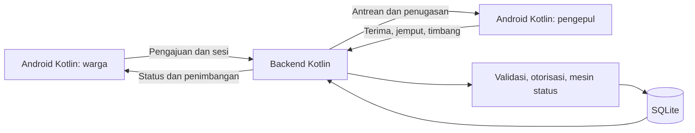

# Recygo

**Dari sampah terpilah ke penjemputan dengan catatan berat yang jelas.**

Proyek kami untuk **Logicodix 2026** · Kategori **Mobile Android** · Bahasa **Kotlin** · Subtema **Green Environment**. Recygo menghubungkan warga dan pengepul dalam MVP demonstrasi lokal: pengajuan, penjemputan, penimbangan, dan konfirmasi warga.

## Tim

**Nama tim:** [Isi Nama Tim Kalian di Sini]

| No. | Anggota | Peran |
| --- | --- | --- |
| 1 | Sagara Dwi Septiansyah | Developer |
| 2 | Arbi Alviano | Developer |
| 3 | Mikael Putra Wibowo | Developer |
| 4 | Denistia Hermawan | UI/UX Designer (Figma) |

> **Catatan Kontribusi:** Seluruh desain antarmuka (*UI/UX*), alur pengguna (*user flow*), dan aset visual dikerjakan oleh **Denistia Hermawan** di Figma sebelum diimplementasikan ke aplikasi Android oleh tim developer, sehingga riwayat *commit* Git hanya menampilkan kontributor kode.
 — [Lihat Desain di Figma](https://www.figma.com/design/7tPzzgzyPQCkhl6UnuFd98/Design-Aplikasi-RecyGo?node-id=0-1&t=G8txcHDWxaJwnrIR-1) |

## Masalah yang kami sasar

Bagi warga rumah tangga, sampah yang sudah dipilah masih membutuhkan langkah pengumpulan berikutnya. Kami menyasar hambatan berupa petunjuk penyetoran yang kurang jelas dan catatan yang tidak konsisten; kebutuhan ini merupakan hipotesis produk, belum hasil wawancara. Jadwal, mekanisme pengumpulan, serta pencatatan jenis dan volume juga menjadi bagian tata kelola bank sampah dalam [Permen LHK 14/2021](https://peraturan.bpk.go.id/Download/285310/Permen%20LHK%20Nomor%2014%20Tahun%202021-.pdf).

Solusi kami ditujukan kepada **warga/rumah tangga dan pengepul**. Warga mengajukan jenis sampah, alamat, dan jadwal; pengepul memproses antrean serta mencatat berat aktual. Konfirmasi warga membuat hasil penimbangan terlihat oleh kedua pihak. Riset dan batas klaim tersedia di [docs/RESEARCH.md](docs/RESEARCH.md); catatan aplikasi tidak membuktikan sampah telah didaur ulang atau pengurangan emisi.

## Fitur utama

- Splash, welcome, penjelasan izin lokasi/notifikasi opsional, dan pilihan peran.
- Pendaftaran warga dua langkah dan pengepul tiga langkah, foto pilihan, serta persetujuan penggunaan data demo.
- Login nomor/email dan password; OTP pendaftaran/lupa password melalui kotak masuk demo lokal. Reset password mencabut seluruh sesi; logout mencabut sesi saat ini.
- Profil di backend: edit kontak/alamat, serta kendaraan dan wilayah pengepul.
- Panduan dan pemilihan plastik, kertas, kaca, serta logam; kategori “Lainnya” ditandai belum tersedia.
- Pengajuan dengan validasi jenis, perkiraan berat, alamat, tanggal, slot WIB, dan catatan.
- Kunci idempotensi untuk mencegah pesanan ganda saat pengajuan yang sama dicoba kembali.
- Antrean pengepul, terima/tolak, mulai perjalanan, konfirmasi tiba, dan input berat aktual.
- Konfirmasi berat oleh warga, pembatalan sebelum perjalanan, pesanan aktif, dan riwayat di SQLite.
- Poin simulasi dari berat aktual; total beranda menghitung pesanan selesai.
- Aset visual dan font tersimpan lokal tanpa URL aset sementara saat aplikasi berjalan.

## Alur penggunaan

1. **Warga** memilih sampah, mengisi perkiraan berat, alamat contoh, dan jadwal, lalu mengajukan penjemputan yang menunggu penerimaan pengepul.
2. **Pengepul** menerima pesanan, memulai perjalanan, dan mengonfirmasi tiba. Penolakan/pembatalan menyimpan alasan.
3. Pengepul memasukkan **berat aktual per jenis sampah**.
4. Warga memuat ulang dan **mengonfirmasi penimbangan**; hasil masuk riwayat dan poin simulasi.

## Teknologi

| Komponen | Teknologi |
| --- | --- |
| Android | Kotlin 2.2.21, native Views, min SDK 26, compile/target SDK 35 |
| Backend | Kotlin/JVM 2.2.21, JDK 17, JDK HTTP Server |
| Database dan JSON | SQLite, Xerial SQLite JDBC 3.46.1.3; Gson 2.11.0 pada server, org.json pada Android |
| SVG dan font | AndroidSVG 1.4, Inter |
| Build | Gradle Wrapper 8.14, Android Gradle Plugin 8.11.1 |
| Pengujian | JUnit Jupiter 5.11.4, Java HTTP Client, Python untuk smoke test |

## Arsitektur dan alur data



Backend menetapkan pemilik, penugasan, status, dan poin; transaksi mencegah dua pengepul menerima pesanan yang sama. Status utama: **Diajukan → Dijadwalkan → Dijemput → Pengepul tiba → Ditimbang → Selesai**. Aplikasi mengambil perubahan saat halaman dibuka atau dimuat ulang. Struktur: `app/` untuk Android, `backend/` untuk API/tes, `scripts/` untuk demo, dan `docs/` untuk dokumentasi. Detail kontrak: [API.md](docs/API.md).

## Instalasi dan menjalankan

Prasyarat Windows: **JDK 17**, Android SDK Platform 35 dan platform-tools, PowerShell, serta Python 3 untuk smoke test. Atur `JAVA_HOME`, `ANDROID_HOME`, dan tambahkan platform-tools ke `PATH` agar `adb` tersedia. Internet diperlukan untuk unduhan dependensi pertama. Jalankan dari root proyek pada **checkout baru tanpa `.env` dan database lama**:

```powershell
.\gradlew.bat :backend:installDist :app:assembleDebug
powershell -NoProfile -ExecutionPolicy Bypass -File scripts/setup-demo.ps1 -FixedDemoAccounts
powershell -NoProfile -ExecutionPolicy Bypass -File scripts/run-backend.ps1
```

Biarkan terminal backend berjalan. Setup membuat `.env`, kunci enkripsi acak, dan file akun demo lokal. Tanpa `-FixedDemoAccounts`, password dibuat acak. Setup mempertahankan `.env` yang sudah ada; password database lama tidak diganti. Untuk instalasi lama, lihat `backend/data/demo-accounts.json`; gunakan checkout baru untuk mencoba kredensial tetap di bawah tanpa mengubah data lama.

### Emulator dan HP melalui USB

Build default terhubung ke komputer melalui `http://10.0.2.2:8080`. Nyalakan emulator, lalu pada terminal lain jalankan `adb -s SERIAL_EMULATOR install -r app/build/outputs/apk/debug/app-debug.apk`; ganti serial berdasarkan `adb devices`.
Untuk HP, aktifkan USB debugging dan setujui komputer pada HP. Pada terminal lain:

```powershell
adb devices
adb -s SERIAL_PERANGKAT reverse tcp:8080 tcp:8080
.\gradlew.bat :app:assembleDebug -PrecygoApiUrl=http://127.0.0.1:8080
adb -s SERIAL_PERANGKAT install -r app/build/outputs/apk/debug/app-debug.apk
```

Ganti `SERIAL_PERANGKAT` dengan serial HP. Pertahankan kabel dan backend aktif; untuk kembali ke emulator, build ulang tanpa properti URL. Debug mengizinkan HTTP hanya ke localhost/host emulator. Release memerlukan HTTPS dan penandatanganan. Hentikan server dengan Ctrl+C pada terminal backend atau `powershell -NoProfile -ExecutionPolicy Bypass -File scripts/stop-backend.ps1`.

### Konfigurasi lingkungan

[.env.example](.env.example) hanya berisi nama variabel; `run-backend.ps1` membaca `.env`, sedangkan Gradle biasa tidak membacanya otomatis. URL Android memakai properti Gradle `recygoApiUrl`. `.env`, database, OTP, dan kredensial lokal diabaikan Git.

| Variabel | Fungsi |
| --- | --- |
| `HOST` | Alamat bind; setup memakai loopback |
| `PORT` | Port API lokal |
| `DATA_DIR` | Direktori SQLite; setup memakai `backend/data` |
| `DEMO_MODE` | Wajib `true` untuk backend demonstrasi |
| `DEMO_RESIDENT_PASSWORD` | Password saat akun warga pertama dibuat |
| `DEMO_COLLECTOR_PASSWORD` | Password saat akun pengepul pertama dibuat |
| `OTP_SIGNING_KEY` | Kunci minimal 32 byte untuk HMAC OTP/enkripsi profil; jangan diganti tanpa migrasi |

## Akun demo dan cara mencoba

Kredensial berikut **sintetis dan sengaja publik**, hanya untuk setup lokal baru dengan `-FixedDemoAccounts`. Jangan gunakan untuk layanan publik atau data pribadi.

| Peran | Email | Password demo |
| --- | --- | --- |
| Warga | `warga@recygo.demo` | `RecygoWargaDemo2026!` |
| Pengepul | `pengepul@recygo.demo` | `RecygoPengepulDemo2026!` |

Nomor login alternatif: warga `080000000001`, pengepul `080000000002`. Coba alur empat langkah di atas dengan bergantian logout/login kedua peran, lalu periksa riwayat dan buka ulang aplikasi untuk melihat data tersimpan.
Untuk pendaftaran baru atau lupa password, baca OTP di komputer backend pada `backend/data/outbox/{challengeId}.json`. Kode berlaku lima menit, maksimal lima percobaan, dan jeda kirim ulang 45 detik. Kode tidak dikembalikan lewat API atau dikirim ke email/WhatsApp. Gunakan identitas, foto, NIK, dan alamat contoh; jangan unggah file akun atau OTP lokal.

## Pengujian

Hasil verifikasi: **19 tes backend lulus** (10 akun dan 9 penjemputan), mencakup OTP/reset/sesi, profil, otorisasi, validasi, idempotensi, penerimaan bersamaan, status, penimbangan, persistensi, dan batas HTTP. Smoke test HTTP lulus untuk pendaftaran/OTP, login nomor, penjemputan lengkap, dan logout. Build APK debug berhasil; lint menghasilkan **0 error dan 10 warning**. Pemeriksaan aset dan login kedua akun demo tetap pada database baru juga lulus.

```powershell
.\gradlew.bat :backend:test :app:assembleDebug :app:lintDebug
python scripts/check-assets.py
python scripts/backend-smoke.py
```

Smoke test memerlukan backend lokal aktif dan menambah data sintetis. Laporan: `backend/build/reports/tests/test/index.html` dan `app/build/reports/lint-results-debug.html`. Validasi ini tidak mencakup audit keamanan independen atau uji beban.

## Privasi dan keamanan

Kami memakai hash password PBKDF2-HMAC-SHA256 bersalt, hash token pada server, serta enkripsi sesi melalui Android Keystore; password tidak disimpan di Android. Profil/pendaftaran tertunda memakai AES-GCM, sedangkan OTP memakai HMAC dan batas percobaan. Reset password mencabut seluruh sesi, logout mencabut sesi aktif. API memeriksa peran/kepemilikan, menggunakan SQL berparameter, dan membatasi ukuran permintaan serta percobaan akun. Backup aplikasi dinonaktifkan; identitas demo tidak diverifikasi resmi.

## Batasan MVP dan rencana lanjutan

MVP berjalan lokal tanpa dispatch atau mitra terverifikasi. SMTP/WhatsApp, GPS/rute/ETA aktual, chat/telepon, push server, pembayaran, penarikan saldo, penukaran hadiah, dan deployment publik belum tersedia. Peta merupakan ilustrasi, notifikasi lokal mengikuti pengambilan status, dan antrean belum disaring berdasarkan wilayah. Pesanan baru dari warga tampil di beranda pengepul melalui pembaruan otomatis in-app saat aplikasi terbuka (siklus ±20 detik); notifikasi saat aplikasi tertutup belum tersedia dan direncanakan memakai push (FCM) atau service latar. Poin simulasi tidak bernilai uang. Prioritas lanjutan kami adalah validasi bersama warga/pengepul, integrasi mitra dan pengiriman OTP, pembatasan wilayah, HTTPS, kebijakan retensi/penghapusan data, serta penanganan perselisihan berat.

## Penggunaan AI

Kami menggunakan **OpenAI Codex**, AI coding assistant, untuk membantu analisis, riset, dokumentasi, kode Kotlin Android/backend, pengujian, dan skrip demo. **Figma MCP** membantu membaca struktur, konteks, screenshot, serta aset desain untuk implementasi native Android. Tidak ada fitur AI di dalam produk; kami bertanggung jawab atas seluruh kode, peninjauan, pengujian, dan penjelasannya.

## Sumber dan atribusi

| Sumber | Penggunaan/lisensi |
| --- | --- |
| [Figma tim](https://www.figma.com/design/7tPzzgzyPQCkhl6UnuFd98/Design-Apk?node-id=0-1) | Desain dan aset visual dari Figma tim; [manifest aset](docs/figma-assets.json). |
| [Inter — Rasmus Andersson](https://github.com/rsms/inter) | SIL Open Font License 1.1; salinan di `app/src/main/assets/fonts/OFL.txt`. |
| [AndroidSVG](https://github.com/BigBadaboom/androidsvg/blob/master/LICENSE) | Renderer SVG, Apache 2.0. |
| [Gson](https://github.com/google/gson/blob/main/LICENSE) | JSON server, Apache 2.0. |
| [Xerial SQLite JDBC](https://github.com/xerial/sqlite-jdbc/blob/master/LICENSE) | Driver SQLite; lisensi/pemberitahuan mengikuti upstream. |
| [Kotlin](https://github.com/JetBrains/kotlin), [Gradle](https://github.com/gradle/gradle) | Bahasa/runtime dan build, Apache 2.0. |
| [JUnit](https://github.com/junit-team/junit-framework/blob/main/LICENSE.md) | Pengujian, Eclipse Public License 2.0. |
| [Permen LHK 14/2021](https://peraturan.bpk.go.id/Download/285310/Permen%20LHK%20Nomor%2014%20Tahun%202021-.pdf), [SIPSN](https://sampahnasional.kemenlh.go.id/portal-indikatif/data/sumber-sampah), [FAQ SIPSN](https://sampahnasional.kemenlh.go.id/portal-indikatif/faq) | Konteks riset; tanpa penyalinan dataset atau klaim agregat nasional. |

Kami tidak menyalin proyek jadi atau template aplikasi lengkap. Launcher/chevron tambahan dibuat untuk Recygo. Library transitif mengikuti lisensi paketnya; lisensi kode Recygo belum ditetapkan.
