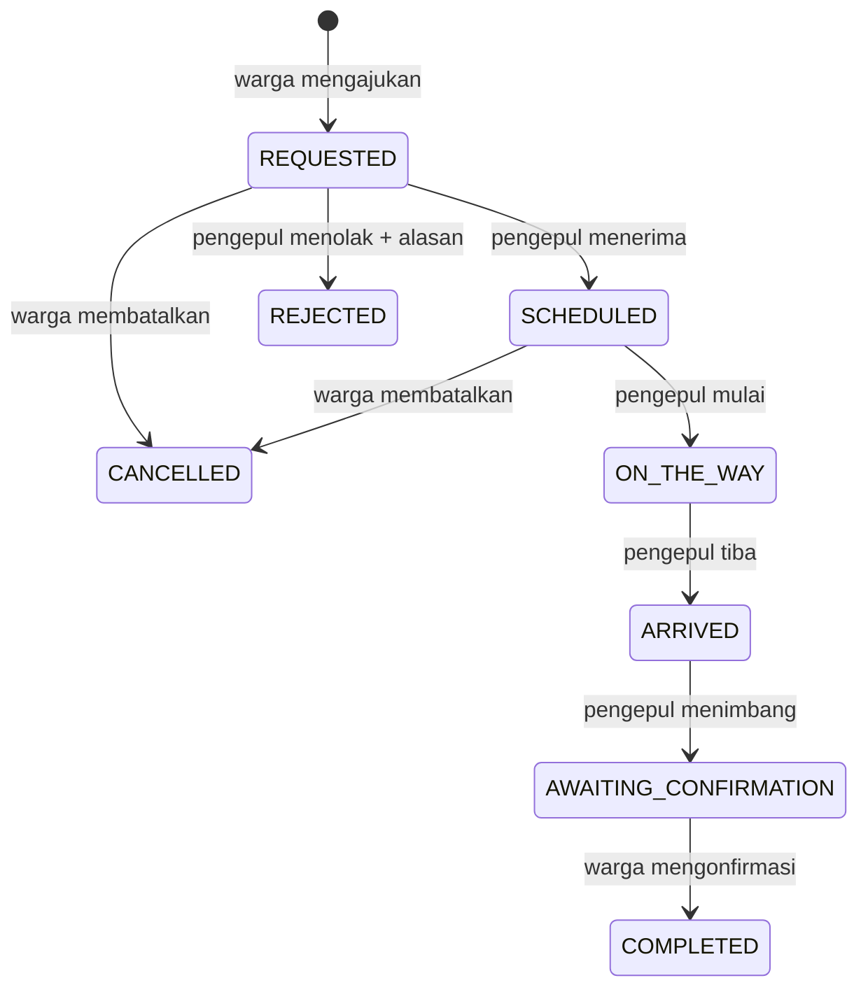

# API demo Recygo

Kotlin/JVM, JDK HTTP Server, JSON UTF-8, SQLite. Default server hanya mendengarkan `127.0.0.1:8080`; demo tidak mengirim petugas nyata. Endpoint akun `login`, `start`, `resend`, `verify`, dan `reset` dapat diakses tanpa sesi. Endpoint `/api` lainnya memerlukan `Authorization: Bearer <session>`. Jangan simpan nilai session di dokumentasi/log.

| Metode | Path | Peran dan hasil |
| --- | --- | --- |
| GET | `/health` | Status layanan dan penanda demo |
| POST | `/api/auth/login` | `identifier` (nomor/email) + `password`; kompatibel dengan field `email`; sesi 24 jam dan user |
| POST | `/api/auth/start` | Memulai OTP `REGISTER` atau `RESET`; mengembalikan challenge ID, email, jeda kirim ulang tanpa kode |
| POST | `/api/auth/resend` | `challengeId`; kirim ulang melalui kotak masuk demo lokal |
| POST | `/api/auth/verify` | `challengeId` + enam digit `code`; registrasi menghasilkan akun/sesi, reset menghasilkan `resetToken` |
| POST | `/api/auth/reset` | `resetToken` + `password`; ganti password dan cabut semua sesi/challenge |
| POST | `/api/auth/logout` | Menghapus sesi saat ini |
| GET | `/api/me` | Identitas sesi dan penanda demo |
| GET | `/api/profile` | Profil akun saat ini, dengan penanda `DEMO_ONLY` |
| POST | `/api/profile` | Perbarui nama, telepon, alamat, RT/RW, wilayah, kendaraan, avatar/koordinat opsional |
| GET | `/api/catalog` | Empat jenis sampah, tarif poin simulasi, slot waktu WIB |
| GET | `/api/orders` | Warga: milik sendiri; pengepul: antrean baru dan pesanan yang ditugaskan kepadanya |
| POST | `/api/orders` | Warga; wajib header `Idempotency-Key`, alamat, tanggal, slot, catatan opsional, dan item |
| GET | `/api/orders/{id}` | Pesanan yang dapat dilihat oleh pemanggil |
| POST | `/api/orders/{id}/accept` | Pengepul mengambil pesanan baru secara atomik |
| POST | `/api/orders/{id}/reject` | Pengepul menolak pesanan baru; alasan 5–300 karakter |
| POST | `/api/orders/{id}/cancel` | Warga membatalkan pesanan sendiri sebelum perjalanan; alasan wajib |
| POST | `/api/orders/{id}/start` | Pengepul yang menerima memulai perjalanan |
| POST | `/api/orders/{id}/arrive` | Pengepul yang sama menyatakan tiba |
| POST | `/api/orders/{id}/weigh` | Pengepul memasukkan gram aktual semua jenis dalam pesanan |
| POST | `/api/orders/{id}/confirm` | Warga mengonfirmasi hasil penimbangan dan menyelesaikan pesanan |

Semua POST memakai `Content-Type: application/json`, termasuk tindakan tanpa parameter dengan objek kosong. Batas body 16 KiB, kecuali pendaftaran/profil 256 KiB. Respons error berupa objek dengan properti `error`; status 400 untuk input, 401 untuk sesi, 403/404 untuk kewenangan, 409 untuk konflik status/kunci pengiriman, 413 untuk body terlalu besar, dan 429 untuk batas percobaan akun.

## Akun dan OTP lokal

`REGISTER` menerima `role` (`RESIDENT`/`COLLECTOR`), `name`, `email`, `password`, `phone`, `address`, `rt`, `rw`, dan `consent=true`. Pengepul menyertakan NIK contoh 16 digit, `vehicle` (`motor`/`pickup`/`truck`) dan `acceptedMaterials`. Avatar/foto identitas base64 bersifat opsional; JPEG/PNG dibatasi 90 KB per gambar dan dimensi maksimal 2048 px. Koordinat opsional divalidasi; bukan pelacakan langsung. Gunakan data sintetis.

Password minimal delapan karakter, berisi huruf dan angka. Email dan nomor harus unik. `RESET` menerima `email`. OTP dan reset grant berlaku lima menit, hanya dapat dipakai sekali. Maksimal lima tebakan OTP, jeda kirim ulang 45 detik, maksimal lima kali kirim ulang. Login/start/resend dibatasi per IP pada demo. Reset mencabut seluruh sesi akun.

Pesan berada pada direktori lokal `backend/data/outbox`, tidak di API. Tidak ada pengiriman email/WhatsApp nyata. `OTP_SIGNING_KEY` mengamankan HMAC OTP, indeks nomor dan enkripsi profil; pertahankan kunci ini untuk membaca data yang sudah tersimpan. Backend menyimpan hash NIK dan empat digit terakhir dalam profil terenkripsi, bukan NIK mentah. Profil tidak menyatakan verifikasi identitas resmi.

## Data permintaan

Payload pengajuan berisi `address` (10–400 karakter), `date` (`YYYY-MM-DD`, hari ini sampai 30 hari ke depan menurut WIB), `slot` (nilai dari katalog), `notes` (maksimal 500 karakter), dan `items`.

Setiap item berisi `materialId` (`plastic`, `paper`, `glass`, `metal`) dan `grams` (bilangan bulat). Berat perkiraan per jenis 100–100.000 gram; total 100–200.000 gram. Jenis tidak boleh berulang. Penimbangan aktual boleh 0 per jenis, tetapi total tetap minimal 100 gram dan kumpulan jenis harus sama dengan pesanan.

Backend menentukan pemilik, pengepul, status, waktu pencatatan, dan poin. Nilai-nilai tersebut tidak dipercaya dari klien. Poin dihitung dari gram aktual dan tarif katalog; hanya pesanan `COMPLETED` yang dijumlahkan sebagai poin warga di aplikasi.

## Mesin status

SQLite menyimpan akun, hash password bersalt, hash sesi beserta kedaluwarsa, dan pesanan. Transaksi serial membuat pemeriksaan status dan pembaruannya atomik untuk skala demo. Kunci pengiriman unik per warga: payload sama mengembalikan pesanan yang sama; payload berbeda dengan kunci sama menghasilkan konflik.

## Batas lingkungan demo

Akun awal dibuat melalui konfigurasi lokal; akun contoh baru dapat didaftarkan melalui OTP demo. Antrean baru tersedia kepada akun pengepul demo yang berwenang; belum ada penyaringan wilayah atau onboarding mitra nyata. Tidak ada GPS langsung, rute/ETA aktual, pembayaran, penarikan saldo, push dari server, atau penjadwal otomatis. Pembaruan status diambil saat halaman dimuat atau tombol muat ulang ditekan.

Server lokal HTTP dipakai melalui USB reverse/emulator. Publikasi memerlukan HTTPS reverse proxy, konfigurasi operasional dan privasi, serta pemeriksaan keamanan tambahan. APK release memblokir HTTP; APK debug hanya mengizinkan HTTP ke localhost dan alamat host emulator.
